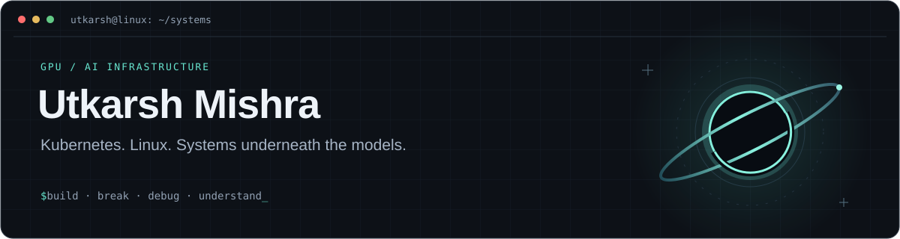

  

  <a href="https://www.linkedin.com/in/utkarsh-mishra-24bb9429a/">LinkedIn</a>
  &nbsp; / &nbsp;
  <a href="mailto:utkarshmishrahe0450@gmail.com">Email</a>
  &nbsp; / &nbsp;
  <a href="https://github.com/Utkarsh56016?tab=repositories">Repositories</a>
  &nbsp; / &nbsp;
  <a href="https://github.com/pulls?q=is%3Apr+author%3AUtkarsh56016+org%3AProject-HAMi">HAMi contributions</a>

### I like knowing what happens underneath.

I'm an ECE undergraduate at **Thapar Institute of Engineering & Technology**, focused on **MLOps and GPU/AI infrastructure**. During my summer internship at **Piramal Finance**, I worked on Kubernetes availability, NVIDIA GPU workers, networking, and platform incident recovery.

My interests run from model execution and GPU scheduling down to container runtimes, Linux processes, drivers, and packet paths. I build labs, reproduce failures, and write down what the evidence supports.

### Open source · HAMi

| Contribution | What I worked on |
| :--- | :--- |
| **[Local GPU Passthrough Lab](https://github.com/Project-HAMi/website/pull/893)** · merged | A reproducible QEMU/KVM → NVIDIA passthrough → Kubernetes → HAMi lab, including fractional CUDA validation and host GPU recovery. |
| **[GPU Memory Dashboard](https://github.com/Project-HAMi/HAMi/pull/2922)** · merged | A Grafana panel comparing scheduler-allocated GPU memory with actual host GPU memory usage. |

### Selected builds

| Project | Under the hood |
| :--- | :--- |
| **[KIRA · Local Linux Assistant](https://github.com/Utkarsh56016/kira-HyprAgent)** | Python daemon, Unix sockets, local Ollama inference, hybrid retrieval, voice input, and gated system commands for Hyprland/Niri. **Alpha.** |
| **[GPU Execution Experiments](https://github.com/Utkarsh56016/Model_execution_learn)** | Small PyTorch experiments exploring data-loading bottlenecks, pinned memory, CUDA streams, autograd overhead, and memory caching. |
| **[zenctl · Linux CPU Control](https://github.com/Utkarsh56016/Zenctl)** | An AMD CPU control CLI with frequency profiles, governor/boost management, sysfs validation, and dry-run support. |

### Infrastructure experience · Piramal Finance

- **Availability:** contributed to expanding Kubernetes control-plane and etcd membership **1 → 3**, then validated API failover on both GPU workers.
- **GPU infrastructure:** re-onboarded a remote **NVIDIA H100 NVL** as an inference-only worker, preserving its host driver and verifying GPU allocation with a real workload.
- **Reliability:** repaired kubelet serving TLS across **5 nodes**, with **101 passing checks and 0 failures**; traced JupyterHub access failures through the API proxy and IPVS dataplane.

### Tools I work with

| Layer | Tools |
| :--- | :--- |
| GPU & orchestration | Kubernetes · Kubespray · NVIDIA GPU Operator · KAI Scheduler · HAMi |
| Linux & networking | Linux · systemd · containerd · Calico VXLAN · IPVS · TCP/IP · TLS/PKI |
| Models & tooling | Python · Bash · PyTorch · FastAPI · Ollama · Ansible |
| Telemetry | Prometheus · Grafana · NVIDIA DCGM |

<b>Beyond the cluster</b>

 

I also build Linux desktop tools, explore UAV telemetry, and spend time thinking about astronomy and complex engineering systems.

- [UAV telemetry interface](https://github.com/Utkarsh56016/UAV-TeliWEB)
- [Network anomaly detection](https://github.com/Utkarsh56016/IDS-System)
- [Infrastructure study log](https://github.com/Utkarsh56016/infra-ai-study)

---

Understand the system. Reproduce the failure. Follow the evidence.

